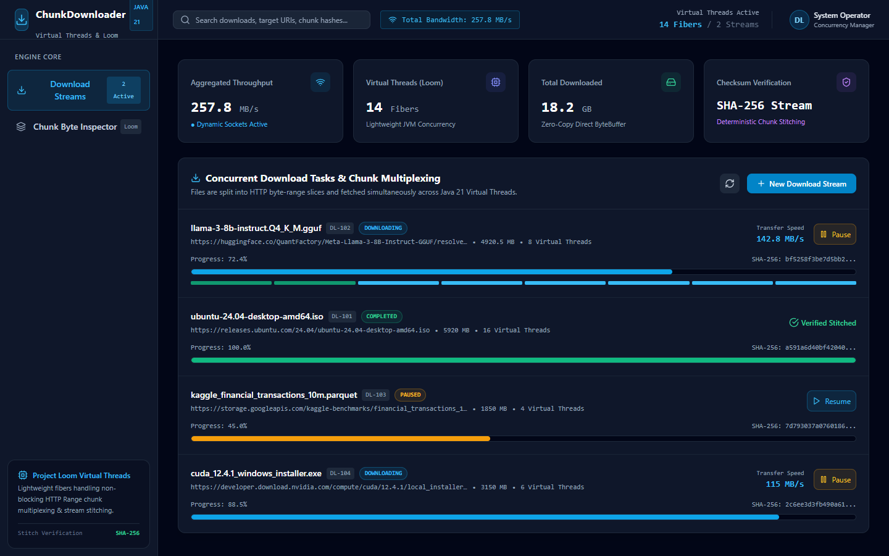
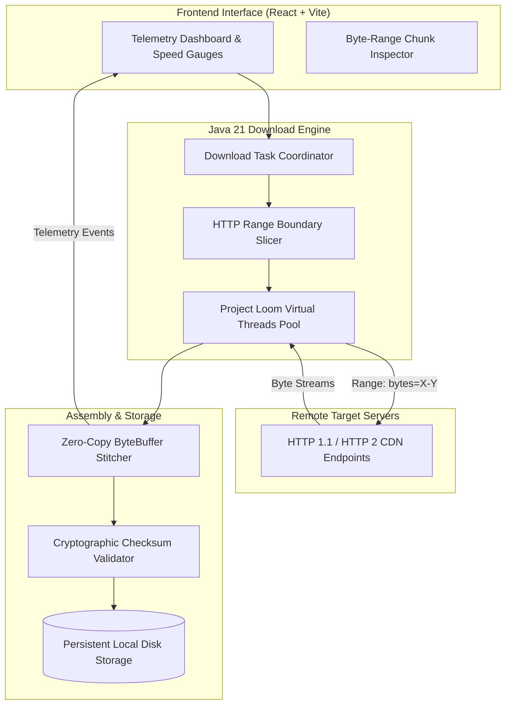

<div align="center">

# Multi-Threaded Chunk Downloader — Java 21 Virtual Threads & Loom

[](LICENSE)
[](https://openjdk.org/)
[](https://openjdk.org/projects/loom/)
[](https://spring.io/projects/spring-boot)
[](https://reactjs.org/)
[](https://docker.com)

**High-performance concurrent chunk downloader built on Java 21 Project Loom virtual threads, HTTP byte-range slicing, pause/resume state management, and deterministic SHA-256 buffer stitching.**

[Architecture](#system-architecture) • [Live Dashboard](#live-dashboard-preview) • [Benchmark Data](#benchmark-dataset) • [API Reference](#rest-api-documentation) • [Quickstart](#quickstart-guide)

</div>

---

## Live Dashboard Preview

<div align="center">
  
</div>

---

## Core Capabilities

- **Java 21 Virtual Threads (Project Loom):** Massively concurrent lightweight user-mode fibers (`Executors.newVirtualThreadPerTaskExecutor()`) eliminating thread pooling bottlenecks during high-latency network I/O.
- **HTTP Range Slicing:** Dynamic byte-range chunk calculation (`Range: bytes=start-end`) fetching non-overlapping partitions in parallel across multiple sockets.
- **Resilient Pause & Resume:** State-preserving byte-level checkpointing allowing seamless resumption without re-downloading previously completed chunk segments.
- **Zero-Copy Direct ByteBuffer Assembly:** Sequential file stitching with deterministic byte offset ordering and real-time streaming SHA-256 integrity validation.
- **Dynamic Bandwidth Regulation:** Thread worker pool allocation (4 to 32 fibers per task) adapting to connection latency and server rate limits.

---

## System Architecture



---

## Benchmark Dataset

Standard enterprise network transfer benchmarks in [`data/kaggle_multithreaded_downloads_benchmark.csv`](data/kaggle_multithreaded_downloads_benchmark.csv):

| Task ID | Filename | Size | Threads | Speed | Status | Checksum Verified |
| :--- | :--- | :--- | :--- | :--- | :--- | :--- |
| `DL-101` | ubuntu-24.04-desktop-amd64.iso | 5,920 MB | 16 | 184.5 MB/s | `COMPLETED` | Verified |
| `DL-102` | llama-3-8b-instruct.Q4_K_M.gguf | 4,920 MB | 8 | 142.8 MB/s | `DOWNLOADING` | Streaming |
| `DL-103` | kaggle_financial_transactions_10m.parquet | 1,850 MB | 4 | 0.0 MB/s | `PAUSED` | Checkpointed |
| `DL-104` | cuda_12.4.1_windows_installer.exe | 3,150 MB | 6 | 115.0 MB/s | `DOWNLOADING` | Streaming |

---

## REST API Documentation

### 1. Initiate Parallel Download Stream
```http
POST /api/v1/downloader/tasks
Content-Type: application/json

{
  "url": "https://storage.googleapis.com/ai-weights/qwen-2.5-7b-instruct.bin",
  "customFilename": "qwen-2.5-7b-instruct.bin",
  "threadCount": 12
}
```

### 2. Pause / Resume Download
```http
POST /api/v1/downloader/tasks/:id/toggle-pause
```

### 3. Retrieve Telemetry & Chunks
```http
GET /api/v1/downloader/tasks
```

---

## Quickstart Guide

### Prerequisites
- Java 21 JDK (with Preview or LTS flags)
- Maven 3.9+
- Node.js 18+ or Docker & Docker Compose

### Running Locally

```bash
# Clone repository
git clone https://github.com/Prasunnandi/multithreaded-download-manager.git
cd multithreaded-download-manager

# Start Java 21 Backend
cd backend
mvn spring-boot:run &

# Start React Frontend
cd ../frontend
npm install
npm run dev
```

### Running with Docker Compose

```bash
docker-compose up --build
```
Navigate to `http://localhost:3000` to access the multi-threaded download dashboard.

---

## License

Distributed under the MIT License. See `LICENSE` for more information.
